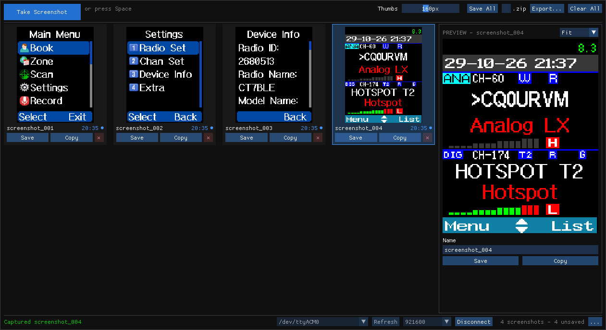
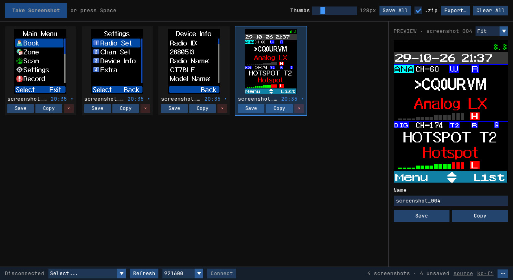

# AT168Shot

<p align="center">
  
</p>

A cross-platform screenshot capture tool for the AnyTone 168 radio display. Captures the 128x160 colour TFT screen via serial connection.

This is the AnyTone 168 fork of [RadShot](../../tree/main), which targets the Radtel RT-4D.



> [!CAUTION]
> This software will ONLY work correctly on screenshot-enabled firmware builds.

> [!IMPORTANT]
> Please don't ask for real time refresh of the display, this would cause a massive slowdown.

## Protocol

| | |
|---|---|
| Command | `SCR` (ASCII, no terminator) |
| Response | 40960 bytes, no header |
| Pixel format | 16-bit RGB565, little endian |
| Layout | 128 consecutive runs of 160 pixels; each run is one display **column** |
| Serial | 8N1, 921600 baud by default (selectable) |

Because the frame arrives column by column, the raw image is the transpose of what the
radio shows and has to be rotated and mirrored to look right. The default (**Rotate 90
CW** + **Mirror**) is that transpose; if a capture still comes out sideways or mirrored,
the Rotation and Mirror controls in the **...** menu (bottom right) cover every other
possibility, and the choice is remembered between runs.

`SCR` is an addition of the screenshot-enabled firmware; it is not part of the stock
AnyTone program-mode protocol, and no handshake precedes it — entering program mode would
put the radio's programming screen on the display, which is not the screen you want to
capture.

### Baud rate

**921600** is what this radio uses for its program-mode link, per
[at168-cps](https://github.com/jcalado/at168-cps) and the at168-flasher tools. 115200 is
the rate qdmr uses for other AnyTone radios, and 4 Mbaud is the firmware-update and
license speed. The picker next to the port carries all of them and the choice is
remembered, so finding the right one needs no rebuild.

**Connect only opens the port** — nothing is written to the radio until you press *Take
Screenshot*.


## Features

- **Serial Connection** - Connect to your AnyTone 168 radio via serial port at a selectable baud rate
- **Auto-Reconnect** - Reopens the last radio on startup and when it is plugged back in; unplugging is detected
- **Screenshot Capture** - Capture the radio's LCD display with a click or the Space key
- **Gallery** - Resizable thumbnails with per-screenshot Save, Copy and Delete, and a resizable preview (fit or 1x-6x)
- **Kept Between Sessions** - Captures are stored as raw frames and come back after a restart or crash
- **Multi-Select & Reorder** - Ctrl/Shift-click to act on several screenshots at once; drag to rearrange
- **Right-Click Menu** - Save, Rename, Copy, Export and Delete on one screenshot or the whole selection
- **Undo** - Delete and Clear All take effect at once and can be undone for a few seconds (Ctrl+Z)
- **Save & Export** - PNGs at a chosen scale (1x-6x); Save All as one .zip or separate files
- **Sequence Export** - Contact sheet, strip, or looping animated GIF of a menu walkthrough, with optional names
- **Clipboard Support** - Copy a screenshot, or several as one contact sheet
- **Orientation Controls** - Rotate and mirror captures to match the physical display
- **Settings Persistence** - Remembers window position, serial port, save directory, orientation and export options
- **Cross-Platform** - Runs on Windows, Linux, and macOS, plus a [web version](#web-version) for Chrome and Edge

### Keyboard shortcuts

| Key | Action |
|---|---|
| Space | Take a screenshot |
| Ctrl+A / Esc | Select all / back to one |
| Del | Delete the selection |
| F2 | Rename |
| Ctrl+Z | Undo the last delete |

## Requirements

- **Windows**: Windows 10 or later
- **Linux**: X11 or Wayland desktop, OpenGL 3.0+
- **macOS**: macOS 11+ (Apple Silicon native)
- AnyTone 168 radio with USB cable
- Appropriate USB-serial drivers installed

## Building

Requires CMake 3.16+ and a C++ compiler.

```sh
cmake -B build -DCMAKE_BUILD_TYPE=Release
cmake --build build --config Release
```

On Windows, you can also use the build script:

```batch
build.bat
```

### Linux dependencies

Install the required development packages:

```sh
# Ubuntu/Debian
sudo apt install libgl1-mesa-dev libx11-dev libxrandr-dev libxinerama-dev libxcursor-dev libxi-dev

# Fedora
sudo dnf install mesa-libGL-devel libX11-devel libXrandr-devel libXinerama-devel libXcursor-devel libXi-devel
```

## Usage

1. Connect your AnyTone 168 radio via USB
2. Launch AT168Shot
3. Select the serial port in the bottom bar and click **Connect** (next time it reconnects on its own)
4. Click **Take Screenshot** (or press Space) to capture the radio display
5. If the image is sideways or mirrored, adjust Rotation and Mirror in the **...** menu
6. Use **Save** to export as PNG or **Copy** to copy to clipboard; **Export...** makes a contact sheet, strip or GIF

Captures are kept in `~/.local/share/at168shot/captures` (Linux),
`%LOCALAPPDATA%\at168shot\captures` (Windows) or
`~/Library/Application Support/at168shot/captures` (macOS) until you delete them.

## Web version

[`docs/index.html`](docs/index.html) is the same tool as a single web page using
[Web Serial](https://developer.mozilla.org/en-US/docs/Web/API/Web_Serial_API), with no
install. It needs a desktop Chromium-based browser (Chrome, Edge, Opera) and an HTTPS or
localhost origin, e.g. GitHub Pages serving the `docs/` folder. On Android, Chrome reaches
the radio over USB-OTG through [web-serial-polyfill](https://github.com/google/web-serial-polyfill)
(WebUSB), bundled as `docs/web-serial-polyfill.js`; iOS has neither API. It has the same features,
keeps captures in the browser, and saves through downloads. Cards can also be dragged out
into rich editors (Google Docs and the like); upload boxes such as GitHub's only receive
the file name, so use Copy and paste there.



### Linux notes

- Add your user to the `dialout` group for serial port access: `sudo usermod -aG dialout $USER` (log out and back in)
- Clipboard copy requires `xclip` (X11) or `wl-copy` (Wayland)
- File dialogs require `zenity` (GNOME) or `kdialog` (KDE)

### macOS notes

- If Gatekeeper blocks the unsigned binary: `xattr -d com.apple.quarantine at168shot`

## Support

If you like my work, you can support me at [ko-fi.com/jcalado](https://ko-fi.com/jcalado)
